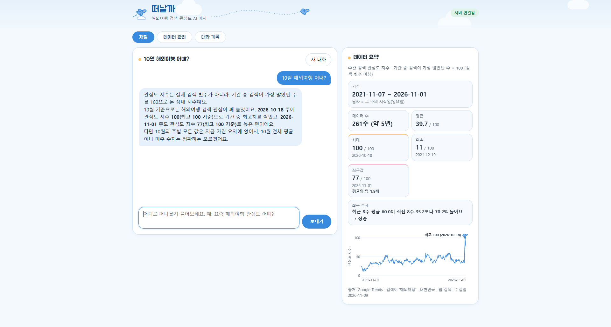
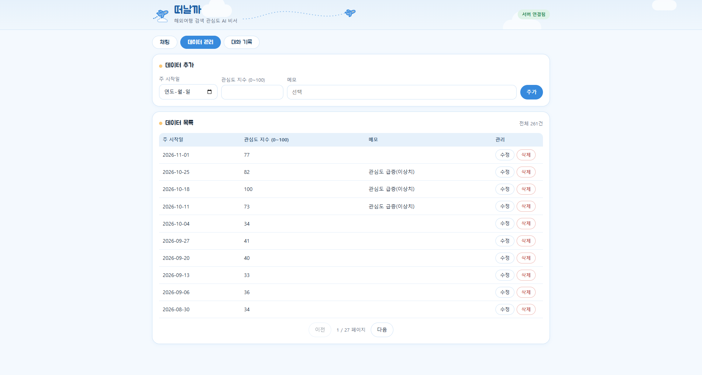
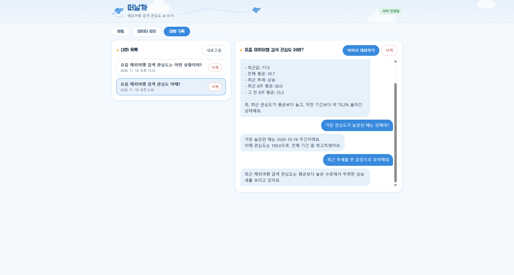

# 떠날까 — 해외여행 검색 관심도 AI 비서

최근 5년간 "해외여행" 검색 관심도 데이터를 요약해 보여 주고, 그 데이터를 바탕으로 질문에 답하는 AI 비서입니다.

코디세이 AI Native 과정 미션 "AI Agent 개발: 나만의 AI 비서 구축"의 결과물입니다.

## 서비스 소개

- 채팅: 데이터 요약을 바탕으로 AI가 질문에 답합니다. 답변을 기다리는 동안 로딩 표시가 나옵니다.
- 데이터 요약: 평균·최대·최소·최근값, 추세, 기간, 그래프를 보여 줍니다.
- 데이터 관리: 주간 관심도 데이터를 추가·조회·수정·삭제합니다.
- 데이터 내보내기(보너스): 전체 데이터를 CSV 또는 JSON 파일로 내려받습니다.
- 대화 기록: 지난 대화 목록을 보고, 선택한 대화를 다시 불러오거나 삭제합니다.

### 사용한 데이터

| 항목 | 내용 |
|---|---|
| 출처 | Google Trends |
| 검색어 / 지역 / 범위 | "해외여행" / 대한민국 / 웹 검색 |
| 수집일 | 2026-11-09 |
| 단위 | 주간 검색 관심도 지수 0~100 (기간 중 검색이 가장 많았던 주 = 100, 검색 횟수 아님) |
| 날짜 | 그 주의 시작일(일요일) |
| 개수 | 261주 (2021-11-07 ~ 2026-11-01). 수집 시점에 끝나지 않은 마지막 1주는 제외 |

## 보너스 기능

| 기능 | 위치 | 내용 |
|---|---|---|
| 데이터 시각화 | 채팅 탭 요약 카드 | 261주 관심도 지수 그래프, 최고점 표시 |
| 데이터 내보내기 | 데이터 관리 탭 | CSV(엑셀 한글 호환), JSON 내려받기 |

## 기술 스택

| 구분 | 사용 기술 |
|---|---|
| 백엔드 | Python 3.13, FastAPI, Uvicorn, Pydantic |
| 데이터베이스 | Firebase Firestore (컬렉션 `data`, `conversations`) |
| AI | OpenAI API (Chat Completions) |
| 프론트엔드 | HTML, CSS, JavaScript (프레임워크 없음) |
| 배포 | Render (API 서버), Vercel (프론트엔드) |

## 배포 URL

| 구분 | 주소 |
|---|---|
| 프론트엔드 | https://tteonalkka.vercel.app |
| API 서버 | https://my-ai-assistant-pjlv.onrender.com |
| API 문서 (Swagger) | https://my-ai-assistant-pjlv.onrender.com/docs |

Render 무료 플랜은 한동안 요청이 없으면 서버가 잠듭니다. 첫 요청은 50초 정도 걸릴 수 있습니다.

## API 목록

| 메서드 | 경로 | 설명 |
|---|---|---|
| GET | `/api/health` | 서버 상태 확인 |
| POST | `/api/data` | 데이터 추가 |
| GET | `/api/data` | 데이터 목록 조회 |
| PUT | `/api/data/{id}` | 데이터 수정 |
| DELETE | `/api/data/{id}` | 데이터 삭제 |
| GET | `/api/data/summary` | 데이터 요약 |
| POST | `/api/conversations` | 대화 생성 |
| GET | `/api/conversations` | 대화 목록 조회 |
| GET | `/api/conversations/{id}` | 대화 하나 조회 |
| DELETE | `/api/conversations/{id}` | 대화 삭제 |
| POST | `/api/chat` | AI 채팅 (대화에 질문과 답변 저장) |

## 폴더 구조

```
my-ai-assistant/
├─ backend/
│  ├─ main.py              FastAPI 앱 진입점
│  ├─ app/
│  │  ├─ config.py         환경 변수 읽기
│  │  ├─ db.py             Firestore 연결
│  │  ├─ schemas.py        요청·응답 형식
│  │  ├─ routers/          API 경로
│  │  └─ services/         요약, 데이터, 대화, 채팅 처리
│  ├─ scripts/             시드 데이터 준비·적재·확인
│  ├─ data/seed.csv        시드 데이터 261주
│  ├─ requirements.txt
│  └─ .env.example         환경 변수 예시
├─ frontend/               index.html, style.css, app.js, config.js, assets/
├─ docs/                   changelog.md, glossary.md
└─ evidence/               단계별 증빙 스크린샷
```

## 로컬 실행 방법

### 1. 백엔드

```bash
cd backend
python -m venv .venv
# Windows
.venv\Scripts\activate
# macOS / Linux
source .venv/bin/activate

pip install -r requirements.txt
```

`backend/.env.example`을 복사해 `backend/.env`를 만들고 값을 채웁니다. 키는 커밋하지 않습니다.

```bash
uvicorn main:app --reload
```

- API: http://127.0.0.1:8000
- Swagger: http://127.0.0.1:8000/docs

### 2. 시드 데이터 넣기 (처음 한 번)

```bash
python scripts/load_seed.py --dry-run   # CSV 검사만
python scripts/load_seed.py             # Firestore data 컬렉션에 적재
python scripts/check_firestore.py       # 적재 확인
```

`data` 컬렉션에 이미 문서가 있으면 적재하지 않고 멈춥니다.

### 3. 프론트엔드

`frontend/config.js`의 `API_BASE_URL`을 `http://127.0.0.1:8000`으로 바꾼 뒤, VS Code Live Server 등으로 `frontend/index.html`을 엽니다 (기본 주소 http://127.0.0.1:5500).

## 환경 변수

| 이름 | 필수 | 설명 |
|---|---|---|
| `ALLOWED_ORIGINS` | 예 | CORS 허용 주소. 쉼표로 구분 (예: 배포 프론트 주소, `http://localhost:5500`, `http://127.0.0.1:5500`) |
| `FIREBASE_SERVICE_ACCOUNT_PATH` | 둘 중 하나 | 로컬: Firebase 서비스 계정 키 파일 경로 |
| `FIREBASE_SERVICE_ACCOUNT_JSON` | 둘 중 하나 | 배포(Render): 키 파일의 JSON 내용 전체 |
| `OPENAI_API_KEY` | 예 | OpenAI API 키 |
| `OPENAI_MODEL` | 아니오 | 사용할 모델. 기본값 `gpt-4o-mini` |
| `OPENAI_MAX_TOKENS` | 아니오 | 답변 최대 토큰. 기본값 400. 추론형 모델은 추론에도 토큰을 쓰므로 넉넉히 설정 |
| `OPENAI_BASE_URL` | 아니오 | OpenAI 호환 서버를 쓸 때만 설정 |

`.env`와 서비스 계정 키 파일은 `.gitignore`로 저장소에서 제외합니다.

## 스크린샷

### 1. 채팅 (데이터 요약과 질문·답변)



### 2. 데이터 관리



### 3. 대화 기록 (목록과 불러오기)



## 참고 문서

- [변경 기록](docs/changelog.md)
- [용어 사전](docs/glossary.md)
- 단계별 증빙: [evidence](evidence/)
