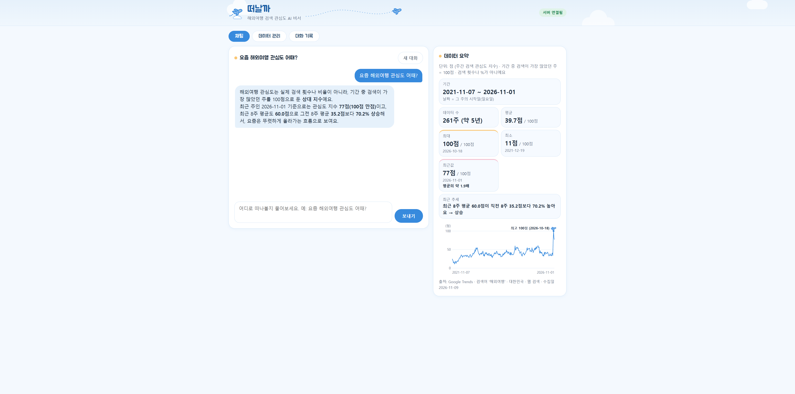
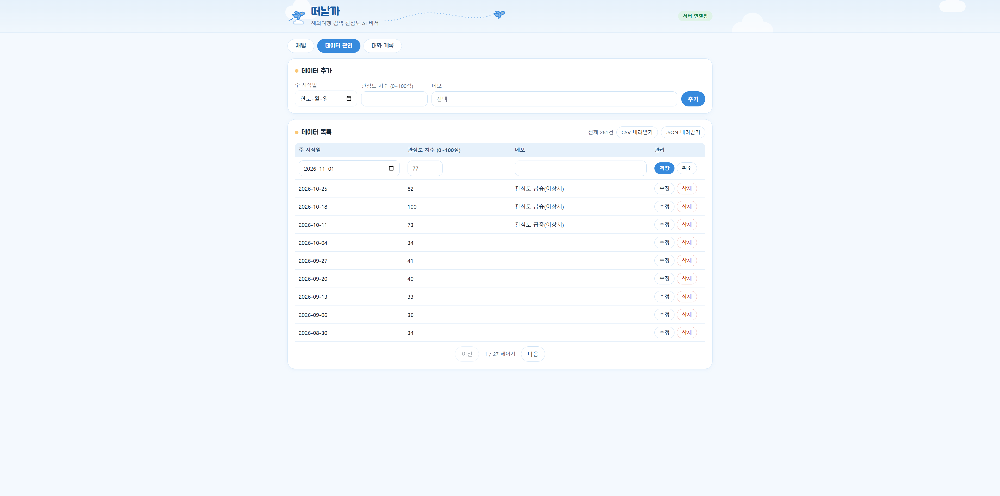
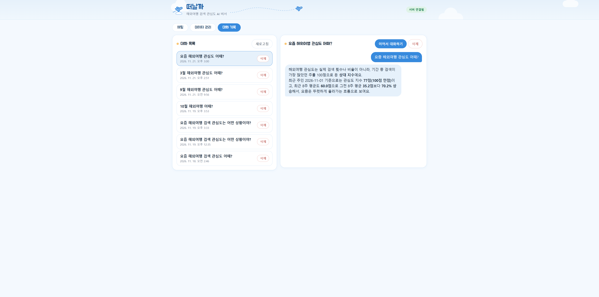

# 떠날까 — 해외여행 검색 관심도 AI 비서

최근 5년간 "해외여행" 검색 관심도 데이터를 요약해 보여 주고, 그 데이터를 바탕으로 질문에 답하는 AI 비서입니다.

코디세이 AI Native 과정 미션 "AI Agent 개발: 나만의 AI 비서 구축"의 결과물입니다.

## 서비스 소개

- 채팅: 데이터 요약을 바탕으로 AI가 질문에 답합니다. 답변을 기다리는 동안 로딩 표시가 나옵니다.
- 데이터 요약: 평균·최대·최소·최근값, 추세, 기간, 그래프를 보여 줍니다.
- 데이터 관리: 주간 관심도 데이터를 추가·조회·수정·삭제합니다.
- 데이터 내보내기(보너스): 전체 데이터를 CSV 또는 JSON 파일로 내려받습니다.
- 대화 기록: 지난 대화 목록을 보고, 선택한 대화를 다시 불러오거나 삭제합니다.

### 사용한 데이터

| 항목 | 내용 |
|---|---|
| 출처 | Google Trends |
| 검색어 / 지역 / 범위 | "해외여행" / 대한민국 / 웹 검색 |
| 수집일 | 2026-11-09 |
| 단위 | 점 (주간 검색 관심도 지수 0~100점, 기간 중 검색이 가장 많았던 주 = 100점, 검색 횟수나 %가 아님) |
| 날짜 | 그 주의 시작일(일요일) |
| 개수 | 261주 (2021-11-07 ~ 2026-11-01). 수집 시점에 끝나지 않은 마지막 1주는 제외 |

## 보너스 기능

| 기능 | 위치 | 내용 |
|---|---|---|
| 데이터 시각화 | 채팅 탭 요약 카드 | 261주 관심도 지수 그래프, 최고점 표시 |
| 데이터 내보내기 | 데이터 관리 탭 | CSV(엑셀 한글 호환), JSON 내려받기 |

PDF 보너스 중 "인사이트·UX 고도화"의 일부(그래프, 내보내기)만 구현했습니다. 다크 모드, 요약 API 지표 추가, Function Calling은 구현하지 않았습니다.

## 기술 스택

| 구분 | 사용 기술 |
|---|---|
| 백엔드 | Python 3.13, FastAPI, Uvicorn, Pydantic |
| 데이터베이스 | Firebase Firestore (컬렉션 `data`, `conversations`) |
| AI | OpenAI API (Chat Completions) |
| 프론트엔드 | HTML, CSS, JavaScript (프레임워크 없음) |
| 배포 | Render (API 서버), Vercel (프론트엔드) |

## 배포 URL

| 구분 | 주소 |
|---|---|
| 프론트엔드 | https://tteonalkka.vercel.app |
| API 서버 | https://my-ai-assistant-pjlv.onrender.com |
| API 문서 (Swagger) | https://my-ai-assistant-pjlv.onrender.com/docs |

Render 무료 플랜은 한동안 요청이 없으면 서버가 잠듭니다. 첫 요청은 50초 정도 걸릴 수 있습니다.

### 배포 확인 결과 (2026-11-21 실제 응답)

| 확인 | 요청 | 응답 |
|---|---|---|
| 백엔드 접속 | `GET /api/health` | `{"status":"ok"}` |
| API 문서 | `GET /docs` | 페이지 제목 "나만의 AI 비서 API - Swagger UI", `/openapi.json`에 경로 11개 |
| 프론트엔드 접속 | `GET https://tteonalkka.vercel.app/` | 페이지 제목 "떠날까 · 해외여행 검색 관심도 AI 비서" |
| API 주소 설정 | `GET https://tteonalkka.vercel.app/config.js` | `API_BASE_URL: "https://my-ai-assistant-pjlv.onrender.com"` |
| 데이터 요약 | `GET /api/data/summary` | `"count": 261`, `"trend": "상승 (최근 8주 평균 60.0, 직전 8주 평균 35.2, 변화율 +70.2%)"` |
| 대화 저장·불러오기 | `GET /api/conversations/{id}` | 질문과 GPT 답변 2개 메시지가 저장되어 있음 |

요청과 응답 전문은 [docs/evidence.md](docs/evidence.md)에 있습니다.

## API 목록

| 메서드 | 경로 | 설명 |
|---|---|---|
| GET | `/api/health` | 서버 상태 확인 |
| POST | `/api/data` | 데이터 추가 |
| GET | `/api/data` | 데이터 목록 조회 |
| PUT | `/api/data/{id}` | 데이터 수정 |
| DELETE | `/api/data/{id}` | 데이터 삭제 |
| GET | `/api/data/summary` | 데이터 요약 |
| POST | `/api/conversations` | 대화 생성 |
| GET | `/api/conversations` | 대화 목록 조회 |
| GET | `/api/conversations/{id}` | 대화 하나 조회 |
| DELETE | `/api/conversations/{id}` | 대화 삭제 |
| POST | `/api/chat` | AI 채팅 (대화에 질문과 답변 저장) |

## 핵심 구현

### 컨텍스트 주입: 데이터 요약을 시스템 프롬프트에 넣기

`POST /api/chat` → `backend/app/services/chat_service.py`의 `chat()`

1. 질문과 대화 ID를 받는다. 대화 ID가 있으면 이전 메시지 중 최근 10개를 가져온다.
2. `data_service.get_summary()`로 요약을 가져온다. `GET /api/data/summary`와 같은 함수다.
3. `build_system_prompt()`가 요약, 데이터 출처, 단위 규칙("77점(100점 만점)"), "요약에 없는 값은 지어내지 않는다" 규칙으로 시스템 프롬프트를 만든다.
4. OpenAI Chat Completions를 호출한다. `max_completion_tokens`로 답변 길이를 제한한다.
5. 질문과 답변을 `conversations`에 저장한다. 새 대화면 첫 질문 앞 30자가 제목이 된다.

```python
summary = data_service.get_summary()
prompt = [{"role": "system", "content": build_system_prompt(summary, first_reply=not history)}]
prompt += history + [{"role": "user", "content": message}]
answer = _call_openai(api_key, prompt)
# 답변을 받은 뒤에만 저장한다
conversation_service.create_conversation(title, new_messages)  # 또는 append_messages()
```

| 이 방식을 고른 이유 | 한계 |
|---|---|
| 원본 261건 대신 요약만 보내 토큰과 비용이 적다 | 특정 주·월 값은 프롬프트에 없어서 답하지 못한다 |
| 데이터를 고치면 다음 질문부터 바로 반영된다 | 요약 지표를 늘리면 프롬프트도 길어진다 |
| 숫자가 요약에서 오므로 GPT가 값을 지어낼 여지가 줄어든다 | 개선 방향: Function Calling으로 기간별 값을 조회 |

실제 답변의 숫자(77점, 60.0점, 35.2점, 70.2%)가 요약 응답과 같은지는 [docs/evidence.md 5장](docs/evidence.md#5-컨텍스트-주입-요약이-gpt-답변에-반영된-증거)에서 비교했습니다.

### 계층별 역할

| 계층 | 파일 | 하는 일 |
|---|---|---|
| 라우터 | `app/routers/*.py` | 주소, HTTP 메서드, 상태 코드(201, 404)만 정한다 |
| 서비스 | `app/services/data_service.py` | `data` 컬렉션 CRUD, 요약 호출 |
| 서비스 | `app/services/conversation_service.py` | `conversations` 생성·조회·삭제·메시지 추가 |
| 서비스 | `app/services/chat_service.py` | 요약 → 프롬프트 → GPT 호출 → 대화 저장, OpenAI 오류를 503·502·429·504로 변환 |
| 서비스 | `app/services/summary.py` | 요약 계산만 하는 순수 함수(DB와 무관). 비교 주 수 `WINDOW = 8`, "유지" 기준 `FLAT_RATE = 5.0`(%) |
| 스키마 | `app/schemas.py` | Pydantic 입력 검증. 형식·범위 검증은 모두 여기서 하고, 서비스는 "대화가 있는가" 같은 존재 확인만 한다 |

### Firestore 컬렉션

| 컬렉션 | 문서 필드 | 정렬·조회 |
|---|---|---|
| `data` | `date`(YYYY-MM-DD 문자열), `value`(0~100 숫자), `memo`(문자열) | `date` 오름차순. 날짜를 문자열로 저장해도 형식이 같아 문자열 순서가 곧 날짜 순서다 |
| `conversations` | `title`, `messages`(`role`·`content` 배열), `created_at`, `updated_at`(UTC ISO 문자열) | 목록은 `updated_at` 내림차순, 목록 응답에는 메시지를 넣지 않는다 |

두 정렬 모두 필드 하나만 쓰므로 Firestore 기본 단일 필드 색인으로 동작한다. 별도 복합 색인은 만들지 않았다.

## 폴더 구조

```
my-ai-assistant/
├─ backend/
│  ├─ main.py              FastAPI 앱 진입점
│  ├─ app/
│  │  ├─ config.py         환경 변수 읽기
│  │  ├─ db.py             Firestore 연결
│  │  ├─ schemas.py        요청·응답 형식
│  │  ├─ routers/          API 경로
│  │  └─ services/         요약, 데이터, 대화, 채팅 처리
│  ├─ scripts/             시드 데이터 준비·적재·확인
│  ├─ data/seed.csv        시드 데이터 261주
│  ├─ requirements.txt
│  └─ .env.example         환경 변수 예시
├─ frontend/               index.html, style.css, app.js, config.js, assets/
│                          build.sh, vercel.json (Vercel 배포 설정)
├─ docs/                   changelog.md, glossary.md
└─ evidence/               단계별 증빙 스크린샷
```

## 로컬 실행 방법

### 1. 백엔드

```bash
cd backend
python -m venv .venv
# Windows
.venv\Scripts\activate
# macOS / Linux
source .venv/bin/activate

pip install -r requirements.txt
```

`backend/.env.example`을 복사해 `backend/.env`를 만들고 값을 채웁니다. 키는 커밋하지 않습니다.

```bash
uvicorn main:app --reload
```

- API: http://127.0.0.1:8000
- Swagger: http://127.0.0.1:8000/docs

### 2. 시드 데이터 넣기 (처음 한 번)

```bash
python scripts/load_seed.py --dry-run   # CSV 검사만
python scripts/load_seed.py             # Firestore data 컬렉션에 적재
python scripts/check_firestore.py       # 적재 확인
```

`data` 컬렉션에 이미 문서가 있으면 적재하지 않고 멈춥니다.

### 3. 프론트엔드

로컬에서는 빌드 없이 `frontend` 폴더를 그대로 엽니다. `frontend/config.js`의 `API_BASE_URL`을 `http://127.0.0.1:8000`으로 바꾼 뒤, VS Code Live Server 등으로 `frontend/index.html`을 엽니다 (기본 주소 http://127.0.0.1:5500).

## 환경 변수

| 이름 | 필수 | 설명 |
|---|---|---|
| `ALLOWED_ORIGINS` | 예 | CORS 허용 주소. 쉼표로 구분 (예: 배포 프론트 주소, `http://localhost:5500`, `http://127.0.0.1:5500`) |
| `FIREBASE_SERVICE_ACCOUNT_PATH` | 둘 중 하나 | 로컬: Firebase 서비스 계정 키 파일 경로 |
| `FIREBASE_SERVICE_ACCOUNT_JSON` | 둘 중 하나 | 배포(Render): 키 파일의 JSON 내용 전체 |
| `OPENAI_API_KEY` | 예 | OpenAI API 키 |
| `OPENAI_MODEL` | 아니오 | 사용할 모델. 기본값 `gpt-4o-mini` |
| `OPENAI_MAX_TOKENS` | 아니오 | 답변 최대 토큰. 기본값 400. 추론형 모델은 추론에도 토큰을 쓰므로 넉넉히 설정 |
| `OPENAI_BASE_URL` | 아니오 | OpenAI 호환 서버를 쓸 때만 설정 |

위 변수는 백엔드(`backend/.env`, Render)에 설정합니다. 프론트엔드(Vercel)는 아래 1개를 씁니다.

| 이름 | 필수 | 설명 |
|---|---|---|
| `API_BASE_URL` | 예 (배포) | 백엔드 API 주소. Vercel 배포 때 `frontend/build.sh`가 이 값으로 `config.js`를 만듭니다. 없으면 저장소의 `config.js` 기본값을 씁니다 |

`.env`와 서비스 계정 키 파일은 `.gitignore`로 저장소에서 제외합니다.

### 배포 환경 설정값 (비밀 값 제외)

| 위치 | 이름 | 넣은 값 |
|---|---|---|
| Render | `ALLOWED_ORIGINS` | `https://tteonalkka.vercel.app,http://localhost:5500,http://127.0.0.1:5500` |
| Render | `FIREBASE_SERVICE_ACCOUNT_JSON` | 서비스 계정 키 JSON 전체 (공개하지 않음) |
| Render | `OPENAI_API_KEY` | OpenAI 키 (공개하지 않음) |
| Render | `OPENAI_MODEL` | `gpt-5.4` |
| Render | `OPENAI_MAX_TOKENS` | `2000` |
| Vercel | `API_BASE_URL` | `https://my-ai-assistant-pjlv.onrender.com` |

Render 설정: Root Directory `backend`, 시작 명령은 `uvicorn main:app --host 0.0.0.0 --port $PORT`. Vercel 설정: Root Directory `frontend`, 빌드는 `frontend/vercel.json`(`sh build.sh`, 출력 폴더 `dist`).

## 스크린샷

### 1. 채팅 (데이터 요약과 질문·답변)



### 2. 데이터 관리



### 3. 대화 기록 (목록과 불러오기)



## 참고 문서

- [변경 기록](docs/changelog.md)
- [용어 사전](docs/glossary.md)
- [요구사항 대조표](docs/requirements-check.md)
- [배포 실행 증빙 (텍스트)](docs/evidence.md)
- [동료평가 발표 자료](docs/presentation.html) (내려받아 브라우저로 열기, ← → 로 이동)
- 단계별 증빙: [evidence](evidence/)
